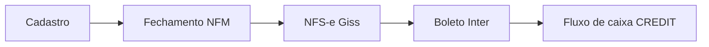

# Onboarding — dpasis_api

Guia de handoff para quem vai manter esta API. Resume o que o código faz hoje e aponta para os documentos longos. Contrato HTTP detalhado: Swagger em `/swagger`.

**Leia primeiro:** este arquivo → [`.cursor/context.md`](.cursor/context.md) → [`.cursor/rules/architecture-dpasis.mdc`](.cursor/rules/architecture-dpasis.mdc).

---

## Sumário

1. [O que é o DPASIS](#1-o-que-é-o-dpasis)
2. [Primeiro dia](#2-primeiro-dia)
3. [Mapa do código](#3-mapa-do-código)
4. [Regras de negócio](#4-regras-de-negócio)
5. [Formato de desenvolvimento](#5-formato-de-desenvolvimento)
6. [Docker](#6-docker)
7. [Variáveis de ambiente](#7-variáveis-de-ambiente)
8. [Banco de dados](#8-banco-de-dados)
9. [Filas, crons e operação](#9-filas-crons-e-operação)
10. [Testes](#10-testes)
11. [Cursor: commands, skills e rules](#11-cursor-commands-skills-e-rules)
12. [Scripts npm](#12-scripts-npm)
13. [Lacunas conhecidas](#13-lacunas-conhecidas)

---

## 1. O que é o DPASIS

API NestJS de back-office para **prestadores de serviço** no Brasil. O ciclo central:

**cadastro** (empresa, cliente, itens, CNAE/NBS/INDOP) → **NFM** (faturamento mensal por cliente, competência e grupo fiscal) → **NFS-e** na prefeitura via **Giss Online** (SOAP + certificado A1) → **boleto/Bolepix** no **Banco Inter** → crédito automático no **fluxo de caixa**.

Ao redor: revenda, prestador, catálogo de serviços, transportadora, vendedor, vouchers, manutenção, templates de e-mail, auditoria HTTP.



Superfície HTTP principal: rotas `/admin/*` com JWT de **ADMIN** + claims CASL. Login: `POST /auth/login`. Papel `SELLER` existe no domínio, mas `STATIC_CLAIMS[SELLER]` está vazio — rotas de vendedor ainda não estão expostas.

---

## 2. Primeiro dia

### Pré-requisitos

- Node.js **20**
- npm
- Docker 20.10+ e Docker Compose 2.0+ (Postgres 16 + Redis 8)
- Criar a pasta `logs/` na raiz (Winston grava arquivos lá)

### Subir localmente (API no host, dependências no Docker)

```bash
cp .env.example .env.development
cp .env.example .env.test
# Preencha JWT_SECRET, DATABASE_URL, REDIS_URL, SSL_*, SMTP_*, AWS_*, CORS_ORIGIN, etc.
# .env.test: DATABASE_URL deve apontar para um banco cujo nome termina em `_test`.

mkdir -p logs

npm run docker:dev:deps          # postgres + redis
npm install

createdb dpasis_test             # ou: docker exec dpasis-postgres-dev createdb -U postgres dpasis_test
npx dotenv -e .env.test -- npx prisma migrate deploy

npm run db:migration             # aplica migrations no banco de development
npm run db:seed                  # admin, claims e fixture de elegibilidade NFM
npm run start:dev
```

- API: `http://localhost:3000`
- Swagger: `http://localhost:3000/swagger`
- Bull Board: `http://localhost:3000/admin/queues` (basic auth `QUEUE_DASHBOARD_*`)

### Seed local

Orquestrado em [`prisma/seeds/index.ts`](prisma/seeds/index.ts). Ativos hoje:

| Seed | Efeito |
|---|---|
| `AdminSeed` | Cria o admin **só se a tabela estiver vazia**: email `admin@email.com`, senha `123456`. Uso exclusivo de máquina local. |
| `AccountClaimSeed` | Concede **todas** as claims do catálogo a contas `ADMIN`. Sem isso, o admin nasce fail-closed e as rotas `/admin/*` respondem 403. |
| `FindElegibleClientsNfmSeed` | Fixture de cliente/itens para o fluxo de fechamento. |

Os demais seeds no arquivo estão comentados.

### Stack completa no Docker (hot reload)

```bash
npm run docker:dev:build
docker compose -f docker-compose.dev.yml exec api npm run db:migration
docker compose -f docker-compose.dev.yml exec api npm run db:seed
```

O compose de **dev não aplica schema na subida** — só `npm run start:dev`. Migrations ficam na sua conta.

Debug Node: porta `9229`. Logs dos containers + arquivos Winston: Dozzle em `http://localhost:9999`.

Coleção Postman: [`postman/README.md`](postman/README.md). Regenerar com `npm run generate:postman`.

---

## 3. Mapa do código

Stack: TypeScript 5.1 (`strictNullChecks`, `noImplicitAny`) · NestJS 10 · Prisma 5.22 (`prismaSchemaFolder`) · PostgreSQL · Redis · BullMQ · CASL · Passport JWT · AWS S3 · Winston.

```
src/
├── app/                 # Bounded contexts (features)
├── core/                # Config, tokens DI, AppException, filter global
├── infra/               # Gateways cross-cutting (Prisma, Redis, filas, S3, Giss, Inter, …)
├── shared/              # Erros transversais e VOs (CNPJ, CPF, Email, Pagination, Password)
├── app.module.ts
└── main.ts              # helmet, compression, CORS, ValidationPipe, Swagger, shutdown hooks
prisma/
├── schema/*.prisma      # um arquivo por contexto
├── migrations/          # versionadas — fonte da verdade do banco
└── seeds/
```

Composição em [`src/app.module.ts`](src/app.module.ts): `CoreModule` + `InfraModule` + módulos de feature.

### Bounded contexts em `src/app/`

| Contexto | Função |
|---|---|
| `authentication` | `POST /auth/login`, JWT, `RolesGuard` + `ClaimsGuard` (CASL) |
| `account` | Contas e `AccountClaim` persistidas |
| `admin` | CRUD de administradores (referência **DDD-light**) |
| `audit` | `AuditInterceptor` global — mutações HTTP vão para `audit_logs` |
| `bank-payment` | Cobrança Inter (emitir, PDF, cancelar, webhook) |
| `cash-flow-entry` | Livro-razão CREDIT/DEBIT por empresa |
| `carrier` | Transportadoras |
| `client` | Agregado cliente + satélites de contrato/faturamento |
| `company` | Empresa prestadora + config NFS-e (cert A1, município, série RPS) |
| `external-apis` | CEP (ViaCEP) e CNPJ (CNPJa) |
| `global` | Cadastros mestres (banco, categoria, FAQ, tributação, e-mail, …) |
| `maintenance` | Crons: recovery NFS-e, alertas, certificados; health HTTP |
| `provider` | Prestadores e itens |
| `resale` | Revendas e contatos |
| `seller` | Vendedores |
| `service` | Catálogo e valores de atendimento |
| `tax-invoice` | NFM + NFS-e |
| `upload-file` | Upload S3 via fila |
| `voucher` | Vouchers de revenda/fabricante |

Agregadores terminam em `ModuleModule` (ex.: `ClientModuleModule`) e listam submódulos.

**`client/`** — `client`, `client-address`, `client-attachment`, `client-attendance`, `client-contact`, `client-discount`, `client-group`, `client-invoice-config`, `client-item`, `client-maintenance-ticket`, `client-owner`, `client-type/` (`client-type`, `client-system-type`, `client-description-type`, `client-drive-type`).

**`company/`** — `company`, `company-nfs-config`.

**`global/`** — `bank`, `billed`, `category`, `delivery-term`, `department`, `email-template`, `email-template-variable`, `freight`, `proposal-validity`, `warranty`, `taxation/` (`cnae`, `nbs`, `indop`, `cnae-nbs-indop`). `faq` e `honorific` também entram no `AppModule`.

**`provider/`** — `provider`, `provider-item`. **`resale/`** — `resale`, `resale-contact`. **`service/`** — `service-catalog`, `service-attendance-value`. **`tax-invoice/`** — `nfm`, `nfse`.

### Infra (`src/infra/`)

| Pasta | Papel |
|---|---|
| `database` | `PrismaService` `@Global` + `truncate()` |
| `cache` | Redis + fake |
| `queue` | BullMQ + Bull Board |
| `logger` | Winston + fake |
| `upload-file` | S3 + fake |
| `cep-lookup` | ViaCEP + fake |
| `cnpj-lookup` | CNPJa + fake |
| `nfs-generation` | Giss SOAP + fake |
| `nf-generation` | NFeMail + fake |
| `bank-payment` | Inter OAuth/mTLS + fake + strategy |
| `alert` | SMTP + fake |
| `provider-attempt` | Registro de tentativas a provedores |
| `throttle` | Rate limit |
| `openapi` | Decorator `@Swagger` |
| `validators/class` | `Queries`, `Params`, `@Trim`, `@StringToNumber`, `@StringToBoolean` |

`NODE_ENV=test` troca adapters reais por fakes em `XxxModule.register()`.

---

## 4. Regras de negócio

Detalhe operacional, armadilhas de UI e referência de rotas: **[`docs/guia-fluxo-nfm-portal-web.md`](docs/guia-fluxo-nfm-portal-web.md)**. Abaixo, o que o backend garante.

### 4.1 Cadastro que o fechamento exige

Ordem prática (guia §4): empresa → config NFS-e → tributação CNAE/NBS/INDOP → cliente → endereços → itens → config de fatura (`clientInvoiceConfig`) + banco.

`CreateClient` ([`create-client.service.ts`](src/app/client/client/application/usecases/create-client/create-client.service.ts)):

- Valida `id` explícito, pai (não pode ser ele mesmo; pai não pode ser subcliente), grupo/revenda/empresa **ativos**; honorific opcional ativo.
- Reserva sequência de id, persiste o cliente, cria endereço `MAIN`.
- Se o endereço falhar, **apaga o cliente** (saga compensatória, sem domain events).
- Invoice config, itens, contatos, owners **não** entram nessa chamada — módulos separados.

### 4.2 Fechamento (NFM)

- Cron **06:00 America/Sao_Paulo** (`nfm-issuance.scheduler.ts`) ou `POST /admin/nfm` — mesmo use case (`RunDailyNfmIssuance`). Lock Redis fail-closed.
- Cliente elegível: tipo contrato, `active`, `generateInvoice`, `clientInvoiceConfig.generateNf`, `dueDateDayMax <= hoje` (BRT), itens ativos.
- Uma NFM por `(clientId, referenceMonth, referenceYear, cnaeNbsIndopId)`. Itens da mesma combinação CNAE×NBS×INDOP viram **um** grupo fiscal. Unique no banco.
- NFM **não tem status próprio**. Estado vive em `nfse.status` + `nfse.bankPayment*`.
- Itens do cliente ficam congelados na NFM gerada: [`docs/frontend-integracao-nfm-client-items.md`](docs/frontend-integracao-nfm-client-items.md).

### 4.3 NFS-e (Giss)

Estados em [`nfse-status.enum.ts`](src/app/tax-invoice/nfse/domain/enums/nfse-status.enum.ts): `PENDING` → `SUBMITTED` → `PROCESSING` → `ISSUED` | `REJECTED` | `FAILED` | `AWAITING_PROVIDER` | `CANCELED`.

- Persistência + outbox na mesma transação, **depois** enqueue (não há outbox genérico no projeto; a fila de NFS-e é o caso especial).
- Idempotência de aplicação: pula NFM que já `hasNfse()`.
- Idempotência de banco: índice único **parcial** `nfses_one_active_per_nfm` — uma NFS-e viva por NFM enquanto o status **não** é `FAILED` nem `REJECTED`. Só existe no SQL da migration `20260903120000_nfse_idempotencia`. `prisma db push` **não** cria esse índice.
- Snapshot em `nfse.data` na criação. Reenvio usa o snapshot.
- Reemissão **somente** por `POST /admin/nfm/:id/reissue`: reconcilia na prefeitura e reaproveita o RPS. Emitir nota que já existe é o erro irreversível do fluxo.
- Classificação ERP (`NFM` | `NFS`) **não vai ao Giss**: `GET /admin/nfse/issued-at-provider` + `POST /admin/nfse/classifications`. [`docs/frontend-integracao-nfse-giss.md`](docs/frontend-integracao-nfse-giss.md).

`AWAITING_PROVIDER` = timeout ambíguo. O backend investiga sozinho. Não é erro de configuração.

### 4.4 Boleto (Banco Inter)

- Disparado depois de `ISSUED`, fila `nfse-bank-payment`.
- `seuNumero` = id da NFS-e; `codigoSolicitacao` → `nfse.bankPaymentRequestCode`.
- Credenciais (client id/secret, URL, certificado) ficam no CRUD de bancos, cifradas. Sem elas no banco da config de fatura a NFS-e emite e a cobrança falha com erro tipado.
- Webhook: `POST /webhooks/inter/cobranca/:token`. O token é gerado no create/rotate do banco e **não** vem mais do `.env`. Recadastre a URL no portal Inter com o token devolvido.
- Confirm também via sweep (≥10 min) se o webhook atrasar.
- Glossário oficial: [`.cursor/docs/banco-inter-api.md`](.cursor/docs/banco-inter-api.md). Campos e UI: [`docs/frontend-integracao-boleto-pagamento.md`](docs/frontend-integracao-boleto-pagamento.md) e [`docs/frontend-integracao-bancos.md`](docs/frontend-integracao-bancos.md).

### 4.5 Fluxo de caixa

- CRUD manual CREDIT/DEBIT com `origin=MANUAL`.
- Pagamento de boleto: `RecordPaidBankPaymentCashFlowEntry` — CREDIT `BANK_PAYMENT`, idempotente por `nfseId`. Cancelamento/expiração **não** lançam. [`docs/frontend-integracao-fluxo-caixa.md`](docs/frontend-integracao-fluxo-caixa.md).

### 4.6 Recuperação automática (sem ação manual)

Scheduler em `nfse-alerts.scheduler.ts` (fuso de Brasília):

| Cron | Job |
|---|---|
| `*/5 * * * *` | `SweepNfseRecovery` — outbox sem despacho (≥60s), reconciliação pendente, `ISSUED` sem job de boleto, leases de cobrança |
| `*/15 * * * *` | Alertas (nota presa, boleto falho, backlog, …) |
| `30 7 * * *` | Reconciliação D+1 |
| `0 8 * * *` | Relatório de fechamento |
| `0 7 * * *` | Certificados a vencer |

Canal único de alerta: SMTP. Sem servidor real, a operação fica cega. Confira `GET /admin/health/smtp` antes de um fechamento.

---

## 5. Formato de desenvolvimento

Arquitetura **hexagonal (Ports & Adapters)** com nomenclatura `drivers` (entrada) / `driven` (saída). **DDD-light** só em módulos com regra rica (entity + factory + repository). CRUD simples: só DAO. **Sem CQRS, sem domain events, sem MediatR.**

Passaporte: [`.cursor/context.md`](.cursor/context.md). Visão de pastas: skill [`architecture-overview`](.cursor/skills/architecture-overview/SKILL.md). Regras absolutas: [`.cursor/rules/architecture-dpasis.mdc`](.cursor/rules/architecture-dpasis.mdc) (11 rules).

```
src/app/<contexto>/<modulo>/
├── <modulo>.module.ts
├── domain/            # ZERO deps de Nest/Prisma/class-validator
├── application/       # use cases, DTOs, ports (DAO / Repository)
└── infra/
    ├── drivers/       # HTTP (admin/user), schedule, consumers BullMQ
    └── driven/        # Prisma, producers de fila
```

Seta de dependência: **de fora para dentro**. `domain/` nunca importa `application/` nem `infra/`.

| Papel | Retorna | Onde |
|---|---|---|
| DAO | DTO | sempre |
| Repository | entidade | só DDD |

- Use case: classe `<Verbo><Entity>`, arquivo `<verbo>-<modulo>.service.ts`, único método público `execute`. Sempre devolve DTO.
- Tokens: **somente** [`src/core/di/token.ts`](src/core/di/token.ts) (`Symbol.for('Nome')`).
- Comunicação entre módulos: importar o `Module` e injetar **use case exportado**. Nunca o DAO de outro contexto.
- Erros: `extends AppException`, mensagem **pt-BR**. Filter global responde `{ message }`. Sem `HttpException` do Nest.
- DTOs de input: classes + class-validator, `@Trim` / `@StringToNumber` / `@StringToBoolean`, `@ApiProperty`. Edit: `PartialType(Create…)`.
- Auth nas rotas admin: `@RequiredRoles(AccountRole.ADMIN)` + `@RequiredClaims(Claim.X_READ|X_WRITE)`. Admin sem linha em `account_claims` = negado.
- Imports: `src/...` (`baseUrl: ./`). Sem barrel `index.ts` em feature. Sem `process.env` fora de `ConfigService` / `main.ts`.
- Enums Prisma: coluna `String`; enum TS no código.
- Scaffold: `npm run generate:module <nome>` (`scripts/cli.ts` + `scripts/templates/`).
- Feature nova: checklist Rule 11. Comando Cursor `/nova-feature`.

Referências de código: CRUD simples → `src/app/global/faq/`. DDD → `src/app/admin/`. Agregado → `src/app/client/`. Fila → `src/app/upload-file/` e `src/app/tax-invoice/nfse/`.

---

## 6. Docker

Detalhe de comandos e troubleshooting: [`README.Docker.md`](README.Docker.md).

| Arquivo | Uso |
|---|---|
| `Dockerfile` | Produção multi-stage (Node 20 Alpine, `dumb-init`, user `nodejs`) |
| `Dockerfile.dev` | Dev, hot reload, portas 3000 e 9229 |
| `docker-compose.yml` | Prod: API + Postgres 16 + Redis 8 |
| `docker-compose.dev.yml` | Dev + tailers de `logs/` + Dozzle |

**Produção** — entrypoint real:

```sh
npx prisma migrate deploy && node dist/src/main
```

`env_file: .env.production`. Compose sobrescreve `DATABASE_URL` (host `postgres`) e `REDIS_URL` (`redis://redis:6379`). Volume somente leitura `./resources/files` → certificados **não** entram na imagem (`.dockerignore`). HTTPS no `main.ts` está comentado; `SSL_*` continua obrigatório no Joi.

**Desenvolvimento** — `command: npm run start:dev`. Sem migrate na subida.

Scripts: `npm run docker:dev`, `docker:dev:detach`, `docker:dev:build`, `docker:dev:deps`, `docker:dev:down`, `docker:prod`, `docker:prod:down`.

---

## 7. Variáveis de ambiente

O app carrega **`.env.${NODE_ENV}`** ([`config.module.ts`](src/core/config/config.module.ts)). `NODE_ENV`: `development` | `production` | `test`. Acessar via `ConfigService` tipado, não `process.env` nas features.

Template: [`.env.example`](.env.example). Arquivos `.env*` (exceto o example) estão no `.gitignore`.

### Sempre obrigatórias (Joi)

| Variável | Para quê |
|---|---|
| `PORT` | HTTP |
| `SSL_KEY`, `SSL_CERT`, `SSL_CA` | Validação de boot. HTTPS no bootstrap está comentado; preencha caminhos válidos mesmo assim |
| `CORS_ORIGIN` | `enableCors({ origin })` |
| `JWT_SECRET` | Assinatura JWT |
| `DATABASE_URL` | Prisma. Teste: nome do banco termina em `_test` |
| `REDIS_URL` | Cache, filas, lock do fechamento |
| `AWS_ACCESS_KEY_ID`, `AWS_SECRET_ACCESS_KEY`, `AWS_REGION`, `AWS_BUCKET_NAME` | S3 |
| `SMTP_HOST`, `SMTP_PORT`, `SMTP_TO`, `SMTP_FROM`, `SMTP_USERNAME`, `SMTP_PASSWORD` | Alertas NFS-e. `SMTP_PORT` é **número** |
| `QUEUE_DASHBOARD_USERNAME`, `QUEUE_DASHBOARD_PASSWORD` | Basic auth do Bull Board |
| `CNPJA_API_URL`, `VIACEP_API_URL` | Lookups |
| `NFEMAIL_API_URL`, `NFEMAIL_CNPJ`, `NFEMAIL_API_KEY` | Gateway NFeMail |
| `SECRETS_ENCRYPTION_KEY` | 64 hex (32 bytes). Cifra AES-256-GCM dos segredos de banco. Trocar a chave órfão os ciphertexts |

### Condicionais

| Flag | Quando `true`, exige |
|---|---|
| `GISS_PROVIDER_ENABLED` | `GISS_CERT_PATH`, `GISS_CERT_PASSWORD` |

Credenciais Inter **não** são variáveis de ambiente: cadastre API keys e certificado no CRUD de bancos (`POST /admin/bank`, `POST /admin/bank/:id/certificate`). Fora de teste a estratégia Inter está sempre registrada.

Opcionais: `THROTTLE_LIMIT` (default 100), `THROTTLE_TTL_MS` (default 60000).

No Compose, defina também `POSTGRES_USER`, `POSTGRES_PASSWORD`, `POSTGRES_DB`, `POSTGRES_PORT`, `REDIS_PORT`, `DOZZLE_PORT` se sair dos padrões.

### Certificados

A1 (Giss) **não é versionado**: `.gitignore` (`*.pfx`, `*.key`, `*.crt`, `*.enc`, …) e `.dockerignore`. Caminho + senha do A1 continuam no env. O certificado Inter é enviado pelo admin (`POST /admin/bank/:id/certificate`) e gravado cifrado em `resources/files/bank-payment/{id}/`. O compose de produção monta `./resources/files` **`:rw`** para esse upload. Na VPS, `chmod 600` e dono exclusivo do usuário da API.

O `.env.example` e o `.dockerignore` citam `docs/runbook-certificados.md`, que **ainda não existe**. Até lá, esta seção + os comentários desses arquivos são a referência.

Health: `GET /admin/health/certificates` (claim `COMPANY_NFS_CONFIG_READ`).

---

## 8. Banco de dados

Prisma 5 com `previewFeatures = ["prismaSchemaFolder"]`. Schema em `prisma/schema/*.prisma`. Model singular, `@@map` plural snake_case.

**Fonte da verdade: migrations versionadas**, não `db push`.

```bash
npm run db:migration           # migrate dev  (.env.development)
npm run db:migration:create    # só gera SQL (índice parcial, backfill)
npm run db:status
npm run db:deploy              # migrate deploy (.env.production)
npm run db:reset               # recreate + seed (dev)
npm run db:seed
npm run db:studio
```

Migrations atuais em `prisma/migrations/`:

- `0_init` — baseline do schema que já existia quando o projeto saiu de `db push`
- `20260903120000_nfse_idempotencia` — índice parcial `nfses_one_active_per_nfm`
- `20260904120000_onda3_reconciliacao`
- `20260904180000_onda4_alertas_e_observabilidade`
- `20260909120000_bank_fine_mora_rates`
- `20260910120000_boleto_retentativa`
- `20260917120000_boleto_settlement`
- `20260917180000_cash_flow_entry`
- `20260921180000_email_templates`
- `20260923120000_nfse_classifications`

Conferir o índice parcial:

```sql
SELECT indexdef FROM pg_indexes WHERE indexname = 'nfses_one_active_per_nfm';
```

Zero linhas = aquele ambiente aceita NFS-e duplicada na mesma NFM.

**Banco que nasceu com `db push`:** o primeiro `migrate deploy` tenta rodar `0_init` em cima de tabelas existentes e quebra. Registrar a baseline **sem** DDL:

```bash
npx dotenv -e .env.production -- npx prisma migrate resolve --applied 0_init
npm run db:deploy
```

**Banco de teste:** `PrismaService.truncate()` recusa qualquer `DATABASE_URL` cujo database name **não** termina em `_test`. A suíte de integração trunca tudo entre specs. Sem essa convenção, `npm test` apontado para o banco de trabalho apaga a base.

Ao criar tabela nova: incluir `tx.<camelCase>.deleteMany()` em `truncate()` na ordem correta de FK.

---

## 9. Filas, crons e operação

Infra global: [`src/infra/queue/queue.module.ts`](src/infra/queue/queue.module.ts). Nomes em [`queue-name.enum.ts`](src/infra/queue/enums/queue-name.enum.ts) e [`job-name.enum.ts`](src/infra/queue/enums/job-name.enum.ts). Padrão por feature: skill [`queue-bullmq`](.cursor/skills/queue-bullmq/SKILL.md).

| Fila | Jobs | Concorrência | Limiter |
|---|---|---|---|
| `nfse-issue` | `issue-nfse-batch` | 2 | 30/min |
| `nfse-poll` | `poll-nfse-batch`, `reconcile-nfse` | 6 | 120/min |
| `nfse-bank-payment` | `issue-nfse-bank-payment`, `confirm-nfse-bank-payment`, `settle-nfse-bank-payment` | 6 | 100/min |
| `upload-file` | `upload-file`, `delete-file` | — | — |
| `client-address` | `resolve-client-address-ibge-code` | — | — |

Jobs de NFS-e que falham ficam 30 dias no Redis (`removeOnFail.age`). Completos são removidos.

`NODE_ENV=test` desliga BullMQ (fakes em memória), salvo `QUEUE_E2E=true`.

`main.ts` liga `enableShutdownHooks()` para o SIGTERM drenar workers — senão NFS-e/boleto morrem no meio e ficam ambíguos.

### Observabilidade

| Recurso | Onde |
|---|---|
| Swagger | `GET /swagger` |
| Bull Board | `GET /admin/queues` |
| Métricas NFS-e | `GET /admin/metrics/nfse` |
| Health SMTP | `GET /admin/health/smtp` |
| Health certificados | `GET /admin/health/certificates` |
| Logs | `logs/<contexto>.log` — http, ws, cache, smtp, upload-file, cep-lookup, cnpj-lookup, nf-generation, nfs-generation, bank-payment, provider-attempt |
| Dozzle (dev) | `http://localhost:9999` |

Não há pipeline CI neste repositório (sem `.github/`). Os badges do README antigo eram do starter Nest.

---

## 10. Testes

Skill: [`testing-strategy`](.cursor/skills/testing-strategy/SKILL.md). Jest `--runInBand`. Co-locação: specs **ao lado** do código, sem pasta `__tests__/`.

| Sufixo | Tipo | Como |
|---|---|---|
| `*.spec.ts` | Unit | `createMock<I>()` do `@golevelup/ts-jest` |
| `*.integration.spec.ts` | Integration | `Test.createTestingModule` + `prisma.truncate()` + Postgres `_test` |
| `*.dto.spec.ts` | DTO | `validateSync` / ValidationPipe |
| `*-prisma.dao.spec.ts` | DAO | banco real |
| `nfse-flow.e2e.integration.spec.ts` | E2E de NFS-e | `QUEUE_E2E=true`, Postgres + Redis |

```bash
npm test                 # unit + integration (precisa do Postgres de teste)
npm run test:e2e         # fluxo NFS-e com BullMQ real
npm run test:cov
npm run lint
npm run build
```

Padrões: `describe('<Sujeito> - Unit tests')`, `let sut`, helper `make…Input`, comentários Arrange/Act/Assert, primeiro `it('should be defined')`. Integration: `beforeEach(prisma.truncate)` + `afterAll` disconnect. Sem `Promise.all` em inserts com unique.

Gerar cobertura no estilo do repo: comando Cursor `/qa-tdd`.

---

## 11. Cursor: commands, skills e rules

A pasta [`.cursor/`](.cursor/README.md) é a **memória arquitetural** versionada com o código. Agente e humano usam a mesma fonte. Atualize a skill no **mesmo PR** em que o padrão mudar.

### Rules (sempre ligadas)

Arquivo real: [`.cursor/rules/architecture-dpasis.mdc`](.cursor/rules/architecture-dpasis.mdc) (`alwaysApply`). Onze regras: camadas, entidades, use cases, DAO/Repository, testes, (não usar) domain events, erros, DTOs, gateways, filas, checklist de feature.

Alguns textos ainda citam `.cursor/rules/RULES.md` ou `.cursor/rules/context.md` — **esses arquivos não existem**. Vale o `.mdc`.

Em divergência: **rules > skills**. Em divergência skill vs código: **código vence** e a skill deve ser atualizada.

### Commands (slash no chat)

| Comando | Quando |
|---|---|
| `/nova-feature` | Feature nova (módulo, CRUD, use case). Lê passaporte + rules + checklist, coleta requisitos, **espera aprovação** e só então implementa. |
| `/feature-checklist` | Revisar PR/diff contra a Rule 11 + skill `code-reviewer`. Sem o pipeline inteiro de feature. |
| `/qa-tdd` | Testes com TDD (RED → GREEN → REFACTOR) + matriz QA do `qa-test-generator`. |

Definições em [`.cursor/commands/`](.cursor/commands/).

### Skills

Cada uma em `.cursor/skills/<nome>/SKILL.md`. O agente carrega pela `description` do frontmatter quando o assunto combina. Para forçar numa sessão nova:

> Leia `.cursor/context.md` e siga `.cursor/rules/architecture-dpasis.mdc` antes de implementar. Use as skills em `.cursor/skills/` conforme o tópico.

| Quero… | Skill |
|---|---|
| Entender a arquitetura / onde fica X | `architecture-overview` |
| Feature do zero | `adding-new-feature` |
| Estrutura de pastas CRUD vs DDD | `module-structure` |
| Use case | `use-case-creation` |
| DAO / Where / paginação Prisma | `dao-pattern` |
| Repository (entidade) | `repository-pattern` |
| Entity / Factory / VO | `domain-modeling` |
| DTO e validação | `dto-and-validation` |
| Token DI | `dependency-injection` |
| AppException | `error-handling` |
| JWT, CASL, claims, guards | `authentication-and-authorization` |
| Controller + `@Swagger` | `controllers-and-swagger` |
| Testes | `testing-strategy` |
| Gerar matriz de testes | `qa-test-generator` |
| Integração externa (S3, Redis, Giss, Inter) | `gateway-adapters` |
| Schema Prisma | `prisma-conventions` |
| Nomes de arquivo/classe | `naming-conventions` |
| BullMQ | `queue-bullmq` |
| AuditInterceptor | `audit-flow` |
| Upload S3 | `upload-file-flow` |
| Doc para o frontend | `frontend-integration-docs` |
| Revisar PR | `code-reviewer` (+ `references/backend.md`, `database.md`, `security.md`, `infra.md`) |

Índice humano: [`.cursor/README.md`](.cursor/README.md) (a lista de skills lá pode estar um pouco atrás desta tabela).

### Rotina sugerida para feature nova

1. `/nova-feature` (ou preencher o formulário da skill `adding-new-feature`).
2. Implementar na ordem da Rule 11: schema → `truncate()` → tokens → pastas → ports → DTOs → adapter → use cases → erros → controllers → claims → module → testes.
3. `/qa-tdd` se a cobertura nasceu incompleta.
4. `/feature-checklist` antes do PR.
5. Se o contrato HTTP admin mudou, skill `frontend-integration-docs`.

---

## 12. Scripts npm

| Script | Faz |
|---|---|
| `start` / `start:dev` / `start:debug` | `NODE_ENV=development` |
| `start:prod` | `NODE_ENV=production node dist/src/main` |
| `build` | `nest build` |
| `lint` | ESLint `--fix` |
| `test` / `test:watch` / `test:cov` / `test:debug` | Jest, `NODE_ENV=test`, `--runInBand` |
| `test:e2e` | `QUEUE_E2E=true` + spec `nfse-flow` |
| `db:*` | Prisma via dotenv (ver [§8](#8-banco-de-dados)) |
| `generate:module` | Scaffold de feature |
| `generate:postman` | Coleção a partir do Swagger |
| `docker:*` | Wrappers do Compose |

---

## 13. Lacunas conhecidas

- **`docs/runbook-certificados.md`** é citado no `.env.example` e no `.dockerignore` e ainda não foi escrito.
- **[`.cursor/README.md`](.cursor/README.md)** ainda aponta para `.cursor/rules/RULES.md` (inexistente) e omite skills mais novas (`code-reviewer`, `frontend-integration-docs`, `upload-file-flow`). A rule válida é `architecture-dpasis.mdc`.
- A skill [`prisma-conventions`](.cursor/skills/prisma-conventions/SKILL.md) ainda descreve `db push`. O código e este guia usam `migrate dev` / `migrate deploy`.
- Não há CI no repositório. Qualidade local: `npm run lint`, `npm test`, `npm run build`.
- `forgot-password` / `reset-password` (`POST /auth/forgot-password` e `/auth/reset-password`, só `ADMIN`) estão ativos. O token é guardado como hash SHA-256 com validade de 60 min e uso único; o e-mail sai pelo gateway `src/infra/account-mail` (SMTP; fake em teste). Exigem a env `PASSWORD_RESET_URL` (URL da tela de redefinição no front) e a migration `20261003130000_account_password_reset_expiry`.
- HTTPS de produção no `main.ts` está comentado; o Joi ainda exige `SSL_*`.
- Superfície `SELLER` sem claims estáticas — não exponha rota de vendedor sem preencher `static-claims.ts` e o catálogo.

---

## Glossário rápido

| Termo | Significado |
|---|---|
| NFM | Faturamento mensal de um grupo fiscal numa competência |
| Grupo fiscal | Itens ativos do cliente com a mesma combinação CNAE/NBS/INDOP |
| RPS | Recibo Provisório de Serviços enviado à prefeitura (número + série + prestador) |
| NFS-e | Nota emitida pela prefeitura (`nfseNumber`, `verificationCode`) |
| Giss | Webservice SOAP da prefeitura (hoje Mauá), certificado A1 da empresa |
| Inter | API de cobrança (boleto + Pix). Identificador: `codigoSolicitacao` |
| Snapshot | Cópia em `nfse.data` usada em todo envio/reenvio |
)
